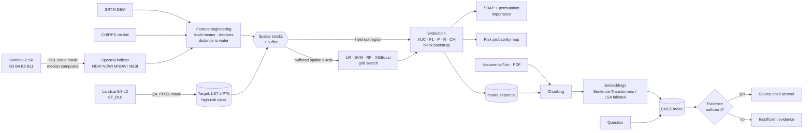
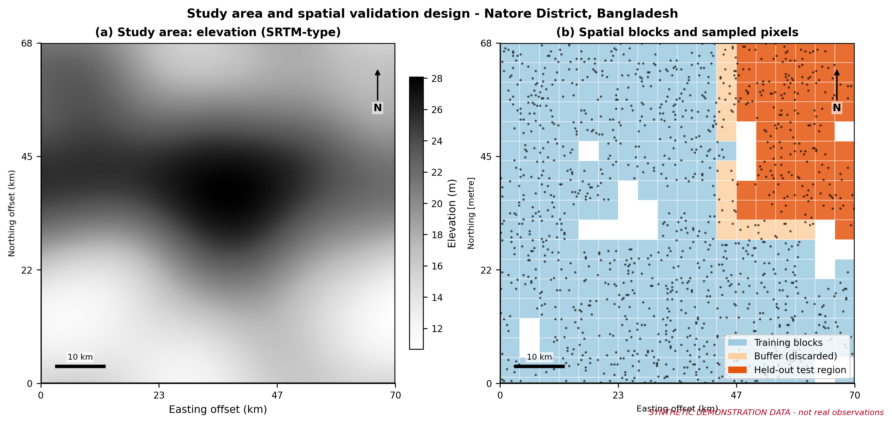
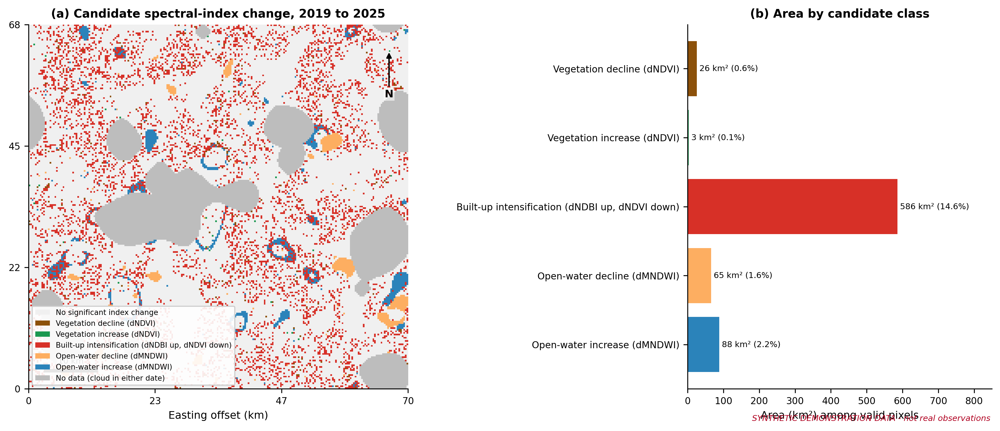
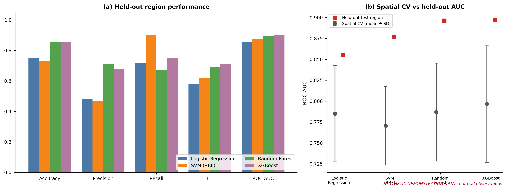
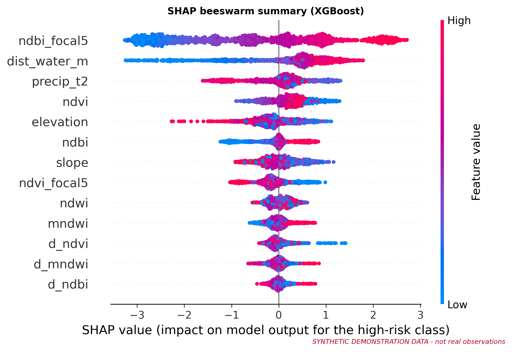
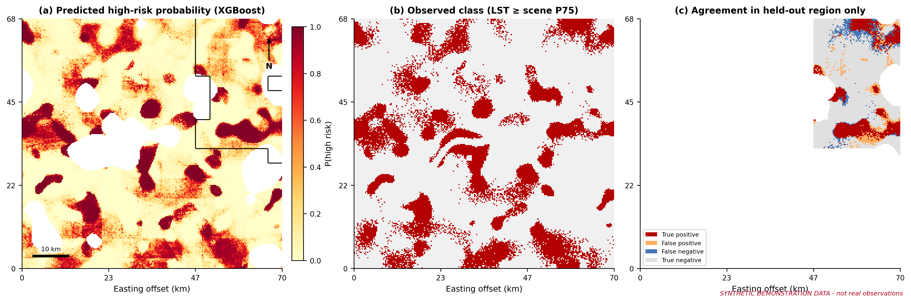
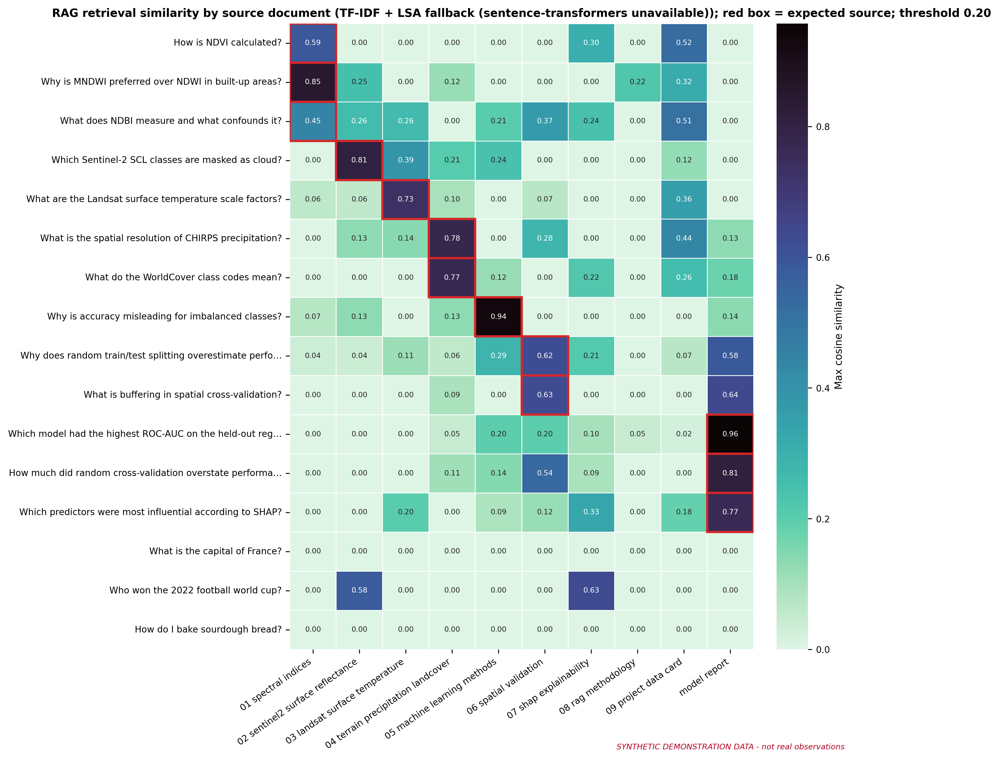

<div align="center">

## GeoRAG-ML

**An Explainable Geospatial Intelligence Framework Integrating Earth Observation, Machine Learning, and Retrieval-Augmented Generation for Environmental Change Analysis and Risk Prediction**


</div>

> ### Read this first: data mode
> The notebook committed here was executed in **synthetic demonstration mode** (no Earth Engine access was available). Every metric, map and SHAP result in it describes a **simulated scene** and verifies that the pipeline works; **none of it is a finding about Natore or any real place.** To produce real results, export the data with `src/gee_acquisition.py`, place the GeoTIFFs in `data/raw/`, and re-run the notebook (it switches to real-data mode automatically). Every figure generated from synthetic data carries a red "SYNTHETIC DEMONSTRATION DATA" tag.

## 1. Overview and motivation

Environmental risk maps built with machine learning are often validated with random train/test splits. On spatially autocorrelated data this overstates accuracy, and the models are rarely connected to the documentation needed to audit them. GeoRAG-ML addresses both problems in one reproducible workflow:

1. **Earth-observation analytics** – cloud-masked Sentinel-2 indices (NDVI, NDWI, MNDWI, NDBI), two-date change screening, terrain and rainfall context.
2. **Leakage-aware, explainable modelling** – four classifiers compared with **buffered spatial cross-validation** and a **geographic hold-out region**, explained with **SHAP**.
3. **Evidence-gated RAG** – FAISS retrieval over methodological documents (plus an auto-generated report of the run's own results) that cites sources and **refuses to answer** when evidence is insufficient.

## 2. Abstract

GeoRAG-ML is a design for transparent geospatial machine learning. A binary *urban heat risk* target (Landsat land surface temperature at or above the study-area 75th percentile) is predicted from Sentinel-2 spectral indices and their changes, neighbourhood context, distance to water, SRTM terrain and CHIRPS rainfall. Target and predictors come from different sensors, coordinates are excluded as features, and preprocessing is contained in pipelines. Models are tuned with buffered spatial block cross-validation and evaluated on a held-out contiguous region with block-bootstrap uncertainty; the gap between random and spatial validation is reported explicitly. SHAP and permutation importance explain the best tree model. A retrieval pipeline answers questions about methods and model performance only from indexed evidence.

## 3. Research objectives

1. Analyse multi-temporal satellite-derived indicators (2019 vs 2025 pre-monsoon composites).
2. Screen environmental change from spectral indices, clearly separated from validated land-cover transitions.
3. Build and compare Logistic Regression, SVM, Random Forest and XGBoost classifiers.
4. Quantify how much random cross-validation overstates performance versus spatial validation.
5. Explain model behaviour with SHAP (summary, beeswarm, importance, dependence).
6. Provide a source-attributed, evidence-gated RAG layer.

## 4. Methodological workflow



## 5. Technology stack

Python 3.10+, NumPy, pandas, SciPy, scikit-learn, XGBoost, SHAP, GeoPandas, Shapely, rasterio, pyproj, Matplotlib, Seaborn, Plotly, FAISS, Sentence-Transformers, pypdf, Google Earth Engine API (data acquisition), Jupyter.

## 6. Repository structure

```
GeoRAG-ML/
├── README.md · LICENSE · requirements.txt · .gitignore
├── config/config.yaml            # all tunables (periods, CV, thresholds, RAG)
├── data/{raw,processed,external}/   # kept empty in git
├── notebooks/GeoRAG_ML_Research.ipynb   # 19-section executed notebook
├── src/
│   ├── remote_sensing.py         # indices, masks, change screening, GeoTIFF IO, synthetic scene
│   ├── preprocessing.py          # feature table, spatial blocks, buffered CV splits, leakage guard
│   ├── modeling.py               # 4 models, spatial tuning, metrics, random-vs-spatial comparison
│   ├── explainability.py         # TreeSHAP + permutation importance
│   ├── rag_pipeline.py           # ingestion, chunking, embeddings, FAISS, evidence-gated QA
│   ├── visualization.py          # 15 publication figures (300 DPI)
│   └── gee_acquisition.py        # Earth Engine export (real-data mode)
├── tests/test_core.py            # 8 unit tests
├── documents/                    # RAG corpus (9 documentation files)
├── figures/                      # 300-DPI PNGs + captions.json
├── models/ · outputs/            # artifacts (large/regenerable files git-ignored)
```

## 7. Installation

```bash
git clone https://github.com/mdkhademali/GeoRAG-ML.git
cd GeoRAG-ML
python -m venv .venv && source .venv/bin/activate      # Windows: .venv\Scripts\activate
pip install -r requirements.txt
python -m pytest -q tests                              # optional sanity check
```

`sentence-transformers` downloads its model on first use. If it cannot be loaded, the RAG layer falls back to TF-IDF + LSA and **reports the active backend**.

## 8. How to run

```bash
jupyter lab notebooks/GeoRAG_ML_Research.ipynb         # Run → Restart Kernel and Run All (≈ 4–6 min on one CPU core)
```
**Real data:**
```bash
earthengine authenticate
python -m src.gee_acquisition --dry-run                # inspect the plan
python -m src.gee_acquisition --project YOUR_CLOUD_PROJECT
# download the 8 GeoTIFFs from Google Drive into data/raw/, then re-run the notebook
```
Optional LLM answers: `export ANTHROPIC_API_KEY=...` (never commit keys). Without a key, answers are extractive evidence only.

## 9. Data sources

| Layer | Earth Engine ID | Role |
|---|---|---|
| Sentinel-2 L2A SR | `COPERNICUS/S2_SR_HARMONIZED` | indices (predictors) |
| Landsat 8/9 C2 L2 | `LANDSAT/LC08/C02/T1_L2`, `LANDSAT/LC09/C02/T1_L2` | LST → target only |
| SRTM 1 arc-second | `USGS/SRTMGL1_003` | elevation, slope |
| CHIRPS daily | `UCSB-CHG/CHIRPS/DAILY` | rainfall context |
| ESA WorldCover v200 | `ESA/WorldCover/v200` | reference land cover (not a predictor) |

## 10. Key visualizations

| | |
|---|---|
|  |  |
|  |  |
|  |  |

All 15 mandatory figures are in `figures/`, with captions in `figures/captions.json`.

## 11. Model evaluation methodology

* **Target leakage:** target from Landsat thermal; predictors from other products; name-level guard `assert_no_leakage`; coordinates not used as features.
* **Pipelines:** median imputation (and scaling for LR/SVM) fitted on training folds only.
* **Spatial design:** pixels grouped into blocks → k-means clusters of blocks form contiguous regions → one region is the final test area; tuning uses buffered spatial K-fold on the rest.
* **Metrics:** accuracy, precision, recall, F1, ROC-AUC, confusion matrices; block-bootstrap 95 % CI for AUC.
* **Why not random splits?** Neighbouring pixels are near-duplicates, so random CV inflates scores; the notebook measures this gap for the same model.

## 12. RAG architecture

PDF/TXT → `pypdf` extraction → sentence-aware chunks (~110 words, 25 overlap) → embeddings (Sentence-Transformers, or TF-IDF+LSA fallback) → FAISS `IndexFlatIP` over unit vectors → top-k → **sufficiency test** (similarity threshold **and** ≥ 34 % keyword overlap) → extractive, source-tagged answer, or *"Insufficient evidence"*. No LLM text is produced unless an API key is configured. The evaluation question set is small and self-authored, so its scores are a plumbing sanity check, not a benchmark.

## 13. Limitations

Synthetic-mode outputs are not evidence; the target is a *relative* late-morning LST class, not heat-stress or health risk; index change is not validated land-cover change; buffering reduces but does not remove spatial leakage and one hold-out region gives one estimate; resolutions differ (CHIRPS ~5.5 km); SHAP explains the model, not causation; the LSA fallback is weaker than dense embeddings. `src/gee_acquisition.py` and the optional LLM path were **not executed** in the development environment. See notebook §17.

## 14. Reproducibility

Global seed 42 (config); versions and configuration saved to `outputs/run_manifest.json`; all tunables in `config/config.yaml`; unit tests in `tests/`. Results can vary slightly across library versions and platforms.

## 15. References

Breiman (2001); Chen & Guestrin (2016); Farr et al. (2007); Funk et al. (2015); Gorelick et al. (2017); Johnson et al. (2019); Lewis et al. (2020); Lundberg & Lee (2017); Lundberg et al. (2020); McFeeters (1996); Olofsson et al. (2014); Pedregosa et al. (2011); Reimers & Gurevych (2019); Roberts et al. (2017); Rouse et al. (1974); Xu (2006); Zha et al. (2003); ESA WorldCover. Full list in notebook §19 (verify details before formal citation).

## 16. Author and citation

**Md Khadem Ali**, Department of Geography and Environment, National University, Bangladesh. [khademali.com](https://khademali.com) · [GitHub](https://github.com/mdkhademali)

```bibtex
@software{ali2026georagml,
  author  = {Ali, Md Khadem},
  title   = {GeoRAG-ML: An Explainable Geospatial Intelligence Framework Integrating Earth Observation,
             Machine Learning, and Retrieval-Augmented Generation},
  year    = {2026},
  url     = {https://github.com/mdkhademali/GeoRAG-ML},
  license = {MIT}
}
```
